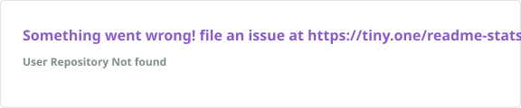
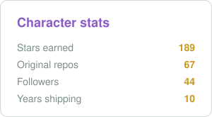

  <picture>
    <source media="(prefers-color-scheme: dark)" srcset="./assets/hero-dark.svg">
    
  </picture>

  
  
  

I'm a software engineer in Lafayette, Louisiana. I've spent ten years shipping backends, frontends, and the cloud plumbing between them. These days most of my work is getting AI agents to open PRs, fix them, and know when to ask a human.

## Quest log

### Adobe (now)

Building agent-driven developer workflows and platform tooling for Adobe engineering teams.

### Liatrio

- **Cursor Forge**: a self-serve course that teaches teams to run an AI software factory with Cursor. GitHub Actions provision each learner a Jira board, a forked app repo, and a Vercel deployment, so they spend their time on the material instead of setup.
- **MergeSmith**: attaches a pull request to a Cursor cloud agent and keeps fixing it until it can merge. You drive it from chat or Slack; the work runs on a cloud VM.
- **forge-infrastructure**: reusable workflows that provision, verify, and tear down per-learner Jira, Confluence, and Slack. The caller passes no secrets.

### Bayer

About six years across Bayer's digital platforms, the last stretch through Dexian on Bayer Global Commerce:

- A production NestJS middleware API and a 22-app Nx React monorepo with shared UI packages
- Terraform-managed AWS (Aurora, ElastiCache, DynamoDB, Lambda, API Gateway) with Datadog on top
- ETL pipelines that move data between SAP ERP, SAP Commerce Cloud, Kafka, SQS, and EventBridge
- AI-assisted workflows and agent templates for ticket triage, code generation, and doc retrieval

## Agents and side quests

  
  
  
  

## Inventory

  <picture>
    <source media="(prefers-color-scheme: dark)" srcset="https://skillicons.dev/icons?i=ts,go,rust,react,nodejs,nestjs,aws,terraform,docker,linux,githubactions,neovim&theme=dark&perline=12">
    
  </picture>

  
  

<b>Character sheet</b> (the quirks)

 

- LeCoq means "the rooster" in French, so the map has a pet one.
- I build my own Fedora Atomic images with [BlueBuild](https://blue-build.org) and contribute upstream.
- I write roguelikes in Rust for the 7DRL game jam ([forgotten-7drl](https://github.com/HexSleeves/forgotten-7drl)), which is why this page is a dungeon.
- My editor is Neovim, I keep more dotfile repos than I'd like to admit, and on a busy day I have more coding agents running than browser tabs.

  <picture>
    <source media="(prefers-color-scheme: dark)" srcset="https://raw.githubusercontent.com/HexSleeves/HexSleeves/output/snake-dark.svg">
    
  </picture>

  

